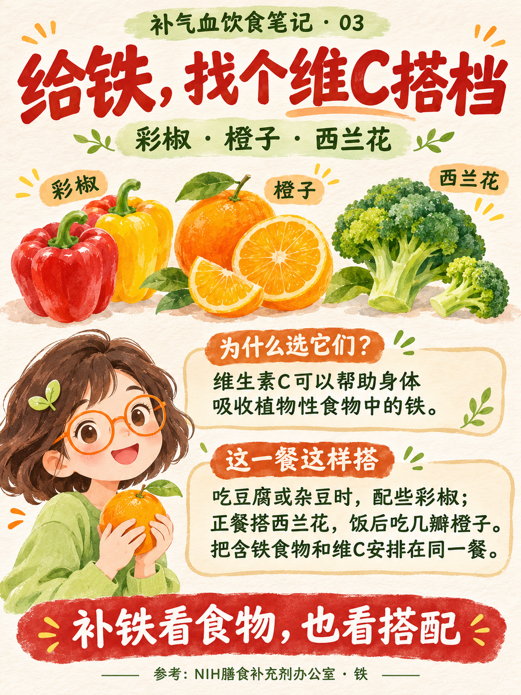

# 小红书健康科普帖

输入一个主题，完成资料核验、1张封面＋4张独立科普图、标题正文和本地保存的 Codex 技能。

## 使用

将本仓库完整放入技能目录，文件夹名为 `xiaohongshu-health-post`，保留 `agents` 和 `assets`。

```text
$xiaohongshu-health-post 主题：改善睡眠
```

需要具备联网检索和内置图片生成能力的 Codex 环境；技能本身不包含模型、密钥或独立图片生成服务。

## 默认产出

- 5张独立3:4竖版图片：封面＋4张内容图。
- 中文标题、可直接发布的正文、话题标签和资料来源。
- 图片生成说明与最终提示词。
- 统一手绘眼镜女孩形象，清新配色，食物名称、营养说明和具体搭配。

默认输出路径沿用作者的 Windows 工作目录 `E:\项目\小红书\<主题>`；其他用户可在请求中指定输出目录或修改 `SKILL.md` 的默认路径。

## 内容原则

优先官方指南、公共卫生机构和原始研究。语气亲切、实用，不重复堆砌免责声明；保留影响结论的证据局限，不把一般营养作用写成治疗承诺。生成后应检查中文、图片内容和来源，再由用户决定发布。

技能只生成并本地保存，不会自动登录或发布到小红书。

## 文件

```text
SKILL.md
agents/openai.yaml
assets/cover-reference.png
assets/content-reference.png
```

## 视觉参考

以下为AI生成的风格参考，不是实拍人物：



